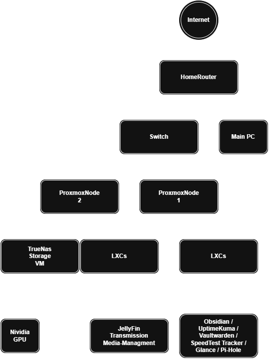

# My Homelab 🖥️

Welcome to my personal homelab documentation repository!

## Overview
My homelab is an environment for learning
virtualization, networking, storage management,
GPU acceleration, and self-hosted applications.

I use Proxmox VE to manage virtual machines
and Linux containers, with network-attached
storage and monitoring services.

## Technology Stack

| Category | Technology |
|---|---|
| Virtualization | Proxmox VE |
| Containers | Linux LXC |
| Media Server | Jellyfin |
| Network DNS | Pi-hole |
| Dashboard | Glance |
| Password and Username Manager | Vaultwarden |
| Storage | TrueNAS / SMB |
| Downloads | Transmission |
| Monitoring | Uptime Kuma / Speedtest Tracker |
| GPU | NVIDIA RTX GPU |

## Goals

- Learn Linux server administration
- Manage virtualization and containers
- Deploy self-hosted applications
- Configure GPU acceleration
- Document troubleshooting

## Documentation

- [Hardware](hardware/ProxmoxNodes.md)
- [Network](infrastructure/network.md)
- [Storage](infrastructure/storage.md)
- [Jellyfin](services/jellyfin.md)
- [Glance](services/glance.md)
- [PiHole](services/PiHole.md)
- [GPU Configuration](hardware/GPUConfiguration.md)

## Architecture

## Future Plans

- [ ] Improve automated backups
- [ ] Expand monitoring
- [ ] Improve network segmentation

## Security

Public documentation contains sanitized
examples only. No credentials or secrets.
