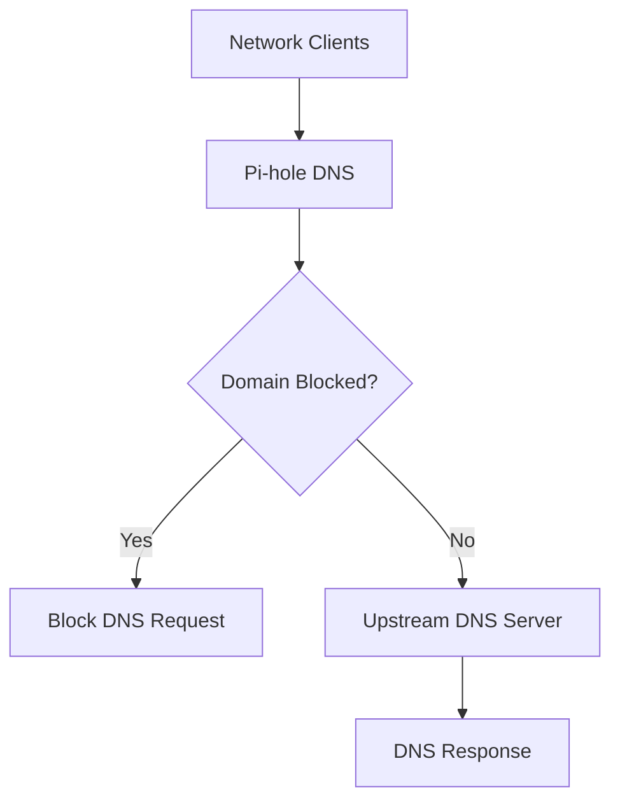

# Pi-hole DNS Server

## Overview

Pi-hole is a network-level DNS filtering solution used
in my homelab to block advertisements, tracking domains,
and other unwanted DNS requests.

The service provides centralized DNS management and
a web dashboard for monitoring DNS activity.

## Server Information

| Component | Configuration |
|---|---|
| Service | Pi-hole |
| IP Address | 99.9.9.999 |
| Web Interface | http://99.9.9.999/admin/ |
| DNS Port | 53 TCP/UDP |
| Deployment | To be documented |
| DNS Upstream | To be documented |
| Monitoring | Glance Dashboard |

## Features

- Network-level advertisement blocking
- DNS query monitoring
- Custom allowlists and denylists
- DNS filtering statistics
- Centralized DNS management
- Integration with Glance

## Network Architecture



This diagram illustrates the intended DNS filtering
process. Router and DHCP integration details
will be documented separately.

## DNS Configuration

Pi-hole listens for DNS requests on port 53.

### Test DNS Resolution

Run this command from a client computer:

```bash
nslookup example.com 99.9.9.999
```

A successful response verifies that the Pi-hole
server can answer a DNS query.

## Pi-hole Administration

### Check Service Status

Run on the Pi-hole server:

```bash
pihole status
```

### View Installed Version

```bash
pihole version
```

### Update Blocklists

```bash
pihole updateGravity
```

### Update Pi-hole

For a supported native installation:

```bash
pihole updatePihole
```

Docker deployments require updating the
container image instead.

## Glance Dashboard Integration

Pi-hole is included in my Glance dashboard
for centralized service monitoring.

Example configuration:

```yaml
- type: monitor
  title: Network Services
  sites:
    - title: Pi-hole
      url: http://99.9.9.999/admin/
      icon: si:pihole
```

## Troubleshooting

### DNS Resolution Failure

Possible causes:

- Pi-hole service is stopped
- DNS port 53 is unavailable
- Incorrect client DNS configuration
- Network connectivity problems
- Upstream DNS server failure

### Diagnostic Commands

Check DNS resolution:

```bash
nslookup example.com 99.9.9.999
```

Check Pi-hole status:

```bash
pihole status
```

View live Pi-hole queries:

```bash
pihole tail
```

## Security Considerations

- Restrict DNS access to trusted networks
- Avoid exposing port 53 to the public internet
- Protect the administration interface
- Keep Pi-hole software updated
- Do not publish credentials or API tokens

## Future Improvements

- [ ] Document deployment platform
- [ ] Document DNS upstream configuration
- [ ] Document router DHCP/DNS settings
- [ ] Add Pi-hole dashboard screenshots
- [ ] Implement or document DNS redundancy
- [ ] Add DNS filtering statistics

## Skills Demonstrated

- DNS administration
- Linux server management
- Network troubleshooting
- DNS filtering
- Self-hosted infrastructure
- Service monitoring
